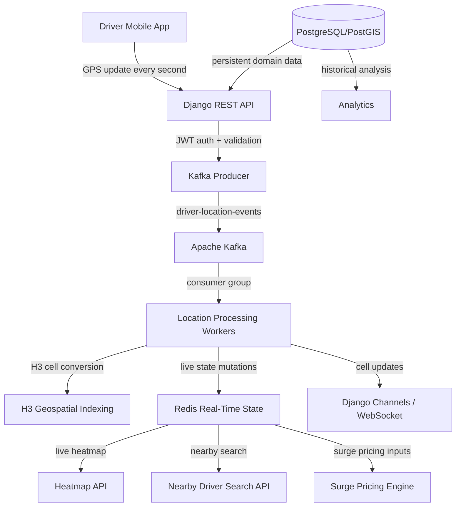

# Real-Time Driver Heatmap Backend

This repository implements the initial backend foundation for a real-time driver tracking, geographical density heatmap, nearby driver search, and dynamic surge pricing system tailored to Nepal.

## Overall Architecture

The system is designed around asynchronous ingestion and real-time state management:

- Driver mobile clients send GPS updates to the Django REST API gateway.
- The API validates the request, authenticates the driver via JWT, and produces Kafka events without doing heavy location processing inline.
- Kafka is the durable event backbone for high-volume geolocation updates.
- Dedicated consumers validate, transform, and enrich each event.
- H3 indexing converts GPS into a consistent hexagonal region key.
- Redis contains the live driver state, cell membership sets, cell counts, expirations, and heatmap aggregates.
- PostgreSQL/PostGIS stores persistent domain data such as cities, driver profiles, surge pricing snapshots, and ride records.
- Django Channels and Redis channel layers broadcast viewport or cell-level updates to connected clients.

## Component Interaction Diagram



## Database Schema

The core persistent schema is intentionally compact and business-focused:

- `Driver`
  - id
  - user_id
  - phone_number
  - vehicle_type
  - city_id
  - is_active
  - availability_status
  - created_at
  - updated_at

- `DriverProfile`
  - driver_id FK
  - full_name
  - license_number
  - rating
  - status_notes
  - profile_version

- `City`
  - id
  - name
  - slug
  - country
  - boundary polygon
  - default_h3_resolution
  - redis_namespace
  - created_at

- `CityBoundary`
  - city_id FK
  - geometry polygon
  - source
  - valid_from
  - valid_to

- `VehicleType`
  - id
  - name
  - capacity
  - base_fare_multiplier

- `DriverLocationHistory`
  - id
  - driver_id FK
  - latitude
  - longitude
  - h3_cell
  - city_id
  - event_timestamp
  - source
  - created_at

- `RideRequest`
  - id
  - rider_id
  - pickup_latitude
  - pickup_longitude
  - destination_latitude
  - destination_longitude
  - pickup_h3_cell
  - status
  - created_at
  - updated_at

- `SurgePricingHistory`
  - id
  - city_id
  - h3_cell
  - vehicle_type
  - multiplier
  - active_requests
  - available_drivers
  - calculated_at
  - explanation_json

This project intentionally keeps one-second GPS stream data in Redis, while PostgreSQL stores durable and analytical records only.

## Redis Key Design

```text
# Driver state
driver:{driver_id} -> hash
  fields: driver_id, latitude, longitude, current_h3_cell, city_id,
          availability_status, last_seen, event_version, heartbeat_ttl

# Cell membership
cell:{city_id}:{h3_cell} -> set of unique driver_ids

# Cell counter (optional derived/maintained with Lua to avoid drift)
cell_count:{city_id}:{h3_cell} -> integer

# Driver expiration tracking
driver_expiry:zset
  score: expiry_epoch_ms, member: driver_id

# Heatmap snapshot
heatmap:{city_id} -> hash or JSON map of h3_cell -> density metadata

# Active ride demand
demand:{city_id}:{h3_cell} -> integer / sorted data

# WebSocket subscriptions
ws:sub:{city_id}:{channel_id} -> set of connection ids
```

The rule is simple: Redis is the source of truth for live availability and per-cell occupancy. PostgreSQL is used for durable business records.

## Kafka Topic and Partition Design

Topic: `driver-location-events`

- Partitions: 12 initial partitions for horizontal throughput and per-driver ordering
- Key: `driver_id` to preserve event ordering per driver
- Producer acks: all
- Delivery: at-least-once with idempotent producer configuration
- Compression: lz4 or snappy
- Retention: 7–14 days depending on requirements
- Dead-letter topic: `driver-location-events-dlq`
- Consumer group: `location-processor-v1`

Design intent:

- Events from the same driver consistently hit the same partition.
- Duplicate events are allowed, but idempotent processing prevents double-counting.
- Consumer offsets are committed only after successful state mutation.

## API Endpoint Design

The first deployment focuses on these endpoints:

- `POST /api/v1/drivers/location/`
  - Authenticated driver location ingestion
  - Validates geolocation and timestamp
  - Publishes to Kafka
  - Returns immediate acknowledgment

- `POST /api/v1/drivers/status/`
  - Updates driver availability state
  - Updates Redis membership and heatmap counts

- `GET /api/v1/heatmap/{city_id}/`
  - Returns cells in the requested viewport
  - Includes density and H3 boundary metadata

- `GET /api/v1/riders/nearby-drivers/`
  - Finds closest available drivers around a rider location

- `GET /api/v1/pricing/surge/`
  - Returns cell-level surge multiplier from supply and demand demand

- `WS /ws/v1/heatmap/{city_id}/`
  - Streaming heatmap updates and cell-level density changes

Additional endpoints will be added as later phases progress.

## Consistency Strategy

The most important correctness rule is that all live driver counts must be derived from unique cell membership and atomic Redis transitions.

Key invariants:

1. A driver contributes exactly once to the count for a cell.
2. Repeated updates in the same cell never increment the total twice.
3. Movement between cells is done in a single atomic Redis Lua script.
4. Expired drivers are removed by comparing timestamps and version numbers to avoid stale expirations.
5. Kafka duplicates are tolerated, but idempotent processing keeps membership state consistent.
6. Unavailable or offline drivers are excluded from the density aggregation.
7. Redis counters must match the unique member set; reconciliation is required after recovery.

The implementation uses Redis transactions or Lua scripts to move driver state from one H3 cell to another atomically, remove stale membership, and update the count in the same operation. Every change is checked against the driver’s `event_version` and `last_seen` so an outdated message cannot overwrite a newer state.

## Phase Roadmap

- Phase 1: Backend infrastructure and environment configuration
- Phase 2: Driver ingestion API and JWT auth
- Phase 3: Kafka processing and idempotent consumers
- Phase 4: H3 and Redis state management
- Phase 5: Heatmap APIs and WebSocket streaming
- Phase 6: Nearby driver search
- Phase 7: Dynamic surge pricing
- Phase 8: Frontend and simulation testing

This repository currently includes the infrastructure skeleton and the first-phase backend foundation.
